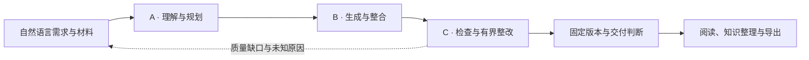

<div align="center">
  

  <h1>AI Edu 2.0</h1>

  <p><strong>说出学习目标，让 AI 生成、检查并交付可阅读的教程、练习与试卷。</strong></p>

  <p>
    <a href="LICENSE"></a>
    
    
    
  </p>
</div>

> AI Edu 2.0 是本地优先、面向单用户的智能教程生成网站。项目仍在持续开发，当前重点是通用主链路、质量闭环、可恢复性和真实交付边界。

## 它能做什么

你可以直接用自然语言描述需求，例如：

> 给我一份定积分入门教程，从面积问题讲起，配 8 道基础练习和 2 道综合题，附答案与解析。

系统会根据完整需求安排内容结构，生成正文与题答，再沿检查、整改和交付链路处理结果。当前覆盖教程、练习、试卷、阅读指引、实践操作与跨学科学习材料。

核心能力包括：

- **自然语言任务**：一次描述目标、难度、时间、题量、题型和输出形式，不必逐项填表。
- **规划、生成、检查分离**：规划先冻结组织方式、知识链、题目蓝图和质量目标；生成与检查分别消费这些约束。
- **过程可观察**：任务状态、阶段、调用与用量可见，支持暂停、恢复、取消、版本历史和固定版本导出。
- **材料驱动**：支持导入文本、Markdown、CSV、带文字层 PDF、纯文本 DOCX 与 EPUB，并保留材料来源和版本关系。
- **面向阅读的界面**：支持章节导航、知识图谱、知识卡、选中文本引用、阅读聊天、跨章整合与 Markdown/ZIP 导出。
- **本地优先**：默认只监听本机地址，数据库、材料、导出和模型配置保存在用户私有目录，不进入 Git。
- **诚实质量出口**：区分演示、草稿、技术检查和专业校准；模型自评或后台完成状态不会被包装成专业通过。

## 工作方式



规划、生成和检查使用版本化合同、hash 绑定与可审计回执。历史失败、未知调用和已结算记录不会被后续成功覆盖。

## 技术栈

| 部分 | 技术 |
| --- | --- |
| Web 前端 | Next.js 16、React 19、TypeScript、Tailwind CSS |
| API 后端 | Python 3.12、FastAPI、SQLite（WAL/FULL） |
| 文档渲染 | React Markdown、GFM、KaTeX、Mermaid |
| 生成与检查 | 可配置模型角色、材料证据、确定性检查、版本化 Skill |
| 兼容层 | Obsidian 插件基线、旧路由只读重定向 |

## 快速开始

### 环境要求

- Windows 10/11 与 PowerShell
- Python 3.12
- Node.js 20.9+
- pnpm

### 1. 安装后端依赖

在仓库根目录执行：

```powershell
python -m venv "$env:LOCALAPPDATA\AI Edu 2.0\venv"
& "$env:LOCALAPPDATA\AI Edu 2.0\venv\Scripts\python.exe" -m pip install -r services/api/requirements-offline.lock.txt
.\scripts\start-backend-v2.ps1
```

后端默认监听 `http://127.0.0.1:8010`。该脚本默认禁止真实付费模型调用；需要真实生成时，必须显式使用 `-AllowPaid` 并配置私有模型角色。

### 2. 启动前端

另开一个终端：

```powershell
Set-Location apps/web
pnpm install --frozen-lockfile
pnpm dev
```

打开 <http://127.0.0.1:3001>。浏览器只访问同源 `/api/*`，由 Next.js 转发到本机 FastAPI 服务。

首次体验可选择演示模式。真实生成涉及外部模型调用和费用，只有完成私有模型配置并显式允许付费后才会执行。

### 一键启动

桌面启动脚本可在已准备好依赖和构建产物后使用：

```powershell
.\scripts\start-aiedu.ps1 -NoPaid
```

`start-aiedu.ps1` 默认走真实调用入口；未配置必需模型角色时会拒绝启动。使用 `-NoPaid` 可安全启动禁付费模式。详细参数见 [后端说明](services/api/README-v2.md)。

## 数据与安全

- 运行数据默认位于 `%LOCALAPPDATA%\AI Edu 2.0`，不在仓库中保存真实数据库、材料或密钥。
- 模型凭据和角色配置只保存在用户私有目录；API 不返回密钥。
- 本地服务限制允许的 Host、Origin 与来源地址，默认仅面向本机单用户。
- 真实模型调用受并发、预算、lease、取消、unknown 隔离和防退化护栏约束。
- 测试使用隔离数据库与隔离材料目录，不应指向个人主库。

不要提交 `.env`、数据库、模型配置、材料原文、日志或导出产物。

## 质量与能力边界

AI Edu 2.0 优先展示真实状态：

- **演示内容不是模型输出**，会在界面和导出中明确标记。
- **技术检查不是专业认证**。结构、覆盖、引用和可执行子集可以确定性验证；专业事实、完整证明和教学效果仍需相应证据。
- **草稿不是最终交付**。缺少独立证据、校准证书或最终质量判断时，系统保留具体缺口，不签“通过”或“优秀”。
- **模型自评不是事实真值**。同模型或同族复核会保留独立性不足的标记。
- **未知调用不会自动重发**。可能需要重复计费或造成数据不一致的操作必须由用户显式确认。

当前版本定位为本地单用户开发基线，不代表已具备多用户、公网运营或生产迁移能力。

## 项目结构

| 路径 | 内容 |
| --- | --- |
| [`apps/web/`](apps/web/) | Next.js 前端、任务工作台、阅读器与浏览器测试 |
| [`services/api/`](services/api/) | FastAPI 后端、v2 API、生成质检链路、数据与迁移 |
| [`services/api/app/v2/`](services/api/app/v2/) | 规划、生成、检查、材料、交付和运行合同 |
| [`obsidian-plugin/`](obsidian-plugin/) | 旧版兼容基线，不表示真实 Vault 已完成验收 |
| [`docs/`](docs/) | 架构说明、ADR、生成合同与 Skill 文档 |
| [`fixtures/`](fixtures/) | 可公开的测试与基准夹具，不包含用户数据 |
| [`scripts/`](scripts/) | 启动、停止、构建、合同生成与架构地图脚本 |

## 开发与验证

后端测试：

```powershell
Set-Location services/api
python -m pytest tests -q
```

前端检查与构建：

```powershell
Set-Location apps/web
pnpm lint
pnpm build
```

跨端合同检查：

```powershell
python scripts/generate_v2_contracts.py --check
```

进一步阅读：

- [后端运行、API 与能力边界](services/api/README-v2.md)
- [技术决策记录](docs/decisions.md)
- [自动生成的架构地图](docs/ARCHITECTURE.generated.md)
- [生成合同 Schema](docs/contracts/generation.v1.schema.json)

## 参与贡献

欢迎提交问题、改进建议和可复现的 Pull Request。提交前请：

1. 说明问题、预期行为与验证方式。
2. 保持前端、后端和生成合同同步。
3. 运行相关测试，并如实区分已验证结果、推断和未验证项。
4. 不提交个人数据、密钥、私有材料或真实运行数据库。

## 许可证

本项目采用 [GNU Affero General Public License v3.0 only](LICENSE)（`AGPL-3.0-only`）许可。

如果你修改本项目并通过网络向用户提供交互服务，请遵守 AGPL 第 13 条，向这些用户提供对应源代码。网络使用不是闭源分发的例外。
