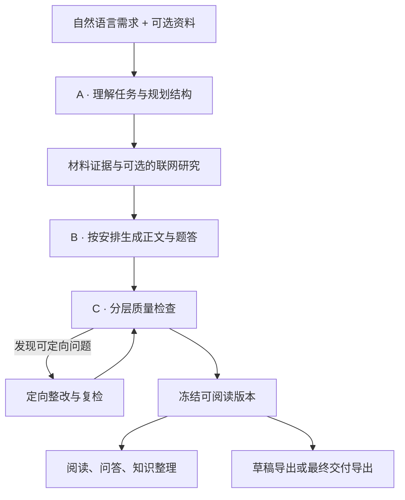

<div align="center">
  

  <h1>AI Edu 2.0</h1>

  <p><strong>把完整学习需求，变成可阅读、可检查、可恢复的学习材料。</strong></p>
  <p>自然语言任务 · 教程 / 练习 / 试卷 · 材料证据 · 阅读问答 · 固定版本导出</p>

  <p>
    <a href="LICENSE"></a>
    
    
    
  </p>
</div>

> AI Edu 2.0 是本地优先、面向单用户的智能教程生成与学习阅读工作台。你只需要描述学习目标、时间、难度、题量和输出形式，系统会把需求理解、结构规划、材料证据、内容生成、质量检查和阅读整理串成一条可追踪的任务链。
>
> 它不是“输入一句话就直接吐出一篇正文”的聊天壳。生成完成、测试通过和后台 `completed` 都不自动等于质量通过；系统会保留哪些检查做了、哪些没有做，以及哪些结论仍然未知。

## 目录

- [为什么选择 AI Edu 2.0](#为什么选择-ai-edu-20)
- [功能总览](#功能总览)
- [一条任务如何完成](#一条任务如何完成)
- [核心功能](#核心功能)
- [典型使用场景](#典型使用场景)
- [技术架构](#技术架构)
- [快速开始](#快速开始)
- [本地、平板与手机访问](#本地平板与手机访问)
- [数据与安全](#数据与安全)
- [质量与能力边界](#质量与能力边界)
- [项目结构](#项目结构)
- [开发与验证](#开发与验证)
- [近期能力演进](#近期能力演进)
- [参与贡献](#参与贡献)
- [许可证](#许可证)

## 为什么选择 AI Edu 2.0

### 1. 不是单一文本生成，而是一条完整学习任务

同一个需求可以产出教程、练习、试卷、参考答案、速查材料和阅读指引。题目与答案按同一题项配对保存，章节可以继续做跨章知识与方法整合。

### 2. 用户意图优先于模板

系统会优先读取你的完整自然语言要求，再决定内容结构、题型分组、题量、难度和输出形式。格式规范用于排版和质量约束，不会用一个默认模板覆盖你的明确目标。

### 3. 材料和证据可以回到原文

支持上传本地资料，也支持导入外部 Markdown 阅读。材料会保留原文、来源、版本和校验信息；引用不完整、材料版本变化或无法确认来源时，系统会明确显示缺口。

### 4. 质量结论不靠模型自夸

正确性检查是必开项，另有完整性、质量专项和定向整改。确定性检查、模型观察、外部证据与专业校准分别记账；草稿可以下载，但不会被包装成专业通过。

### 5. 过程可见，失败可继续

任务支持暂停、恢复、继续生成和显式隔离未知调用。每次模型调用的阶段、耗时、token、费用、重试来源和未知状态都进入任务证据；历史失败不会被后续成功覆盖。

## 功能总览

| 功能域 | 你可以做什么 | 关键能力 |
| --- | --- | --- |
| 任务入口 | 用一句话描述完整学习需求，按需补充学科、模式和范围 | 自动匹配、显式选择、需求冲突提示、学习范围判断 |
| 内容生成 | 生成教程、知识讲解、实践操作、阅读指引、练习和计分试卷 | 结构化规划、章节生成、题答配对、跨章整合、任务适配格式 |
| 材料驱动 | 上传资料或导入已有 Markdown，结合本地材料生成 | txt、Markdown、CSV、带文字层 PDF、DOCX、EPUB；原文与版本保留 |
| 资源库 | 管理格式规范、知识资产、命题、质量量规和资料 | 规范导入、知识图谱、题目与原理、评价体系、归档与回收站 |
| 质量检查 | 检查生成题目与答案是否正确 | 当前网页固定只跑题答正确性；有错误时生成可执行修复指令，B 定向修复后复检并直接放行或显式失败 |
| 阅读学习 | 阅读生成内容，围绕当前版本提问和整理知识 | 目录、进度、问题标记、字号与主题、选中引用、整篇或指定章节问答 |
| 可恢复运行 | 中断后继续，遇到未知调用时先核对回执 | 暂停、恢复、幂等键、unknown 隔离、迟到回执、调用与费用记录 |
| 固定版本导出 | 下载稳定的 Markdown 文档或 ZIP 学习包 | 固定版本、题答分离、质量清单、草稿与最终交付区分 |
| 模型与设置 | 配置理解、生成、质检和答疑角色 | 模型档案、工作流角色、并发设置、模型发现、密钥只在私有目录 |
| 本地与移动 | 在本机使用，也可在手机和平板上阅读 | 默认仅本机访问、数据不进 Git、响应式阅读、主屏安装元信息 |

## 一条任务如何完成



规划、生成和检查使用版本化合同、hash 绑定与可审计回执。每次运行都记录阶段、调用和结果；没有发生的检查不会显示为通过，历史失败也不会被新一次成功改写。

## 核心功能

### 1. 用自然语言发起任务

在新建任务页写下你的完整目标即可，例如：

> 给我一份定积分入门教程，从面积问题讲起，配 8 道基础练习和 2 道综合题，附答案与解析。

你可以按需描述：

- 学习目标、已有基础和学习时间
- 目标难度、题型、题量和输出形式
- 希望覆盖或避开的章节
- 参考资料、来源和适用范围
- 是否需要联网研究、质量专项检查或定向整改
- 整条任务的模型调用上限

高级选项不填也可以。系统会根据原话自动匹配，但你在学科、模式和学习范围中的明确选择优先级更高。若需求出现冲突，例如同时要求答案却没有题目，系统会先保存草稿并提示你确认，而不是静默猜测。

当前用户端只走真实生成入口。后端没有开启模型调用时，页面会明确说明无法开始，不会自动降级成演示内容。

### 2. 覆盖多种学习产出

| 产出 | 适合的场景 |
| --- | --- |
| 通用教程 | 从零学习一个主题，强调解释、例子和练习 |
| 知识讲解 | 围绕概念、原理和知识关系展开 |
| 实践操作 | 需要步骤、工具、风险提示和可执行检查的任务 |
| 阅读指引 | 围绕已有材料组织阅读路线、重点和讨论问题 |
| 练习 | 不计分训练，强调覆盖、反馈和逐步练习 |
| 试卷 | 计分测评，强调题型结构、题答配对和验收要求 |

系统支持章节级和全书级内容。你可以先生成可读章节，再根据任务要求做总结、跨章知识与方法整合，最后冻结版本进入阅读或导出。

### 3. 材料驱动和原文可追溯

新建任务时可附加本地材料：

- `.txt`
- `.md` / `.markdown`
- `.csv`
- 带文字层的 `.pdf`
- `.docx`
- `.epub`

扫描件、旧版 `.doc` 和 `.ppt` 不在当前支持范围内。资料会被当作来源，不会被当作提示词指令。上传、确认和启动是分开的步骤，避免还没确认来源就开始生成。

此外，导入页支持把外部 Markdown 保存为只读学习任务：

- 优先按 Markdown 标题、中文编号和加粗标题识别结构
- 没有明确章节时退化为普通长文阅读
- 原文切片完整保存，不因目录识别而删除或重排
- 可附带同目录图片，原始引用路径不会被静默改写
- 低置信度时可以让答疑模型确认原文中已有的标题行，但不会新增或改写正文

### 4. 质量检查、整改和交付是分开的

当前网页新建任务固定使用 `correctness_only.v1`：

- C 只检查每道生成题目的题干、最终答案和必要推理是否有具体错误。
- 不检查章节覆盖、结构、知识组织、教学效果、实测难度、引用广度或排版。
- 检查发现可定位错误时，输出绑定 finding 的 `RepairDirective`；B 只按指令修改目标题，随后只复检题答正确性。
- 复检通过后直接签 `final`；仍有错误时允许第二个有界修复轮次，耗尽后显式失败并保留最佳草稿。
- `not_calibrated` 原样保留。题答未发现错误不等于专业校准、教学效果或学习收益通过。

旧的完整质量检查套件已作为 `services/api/quality_suite_archive/full_v1` 冻结，并通过适配器保留给历史兼容和后续独立任务；当前用户界面不再提供质检层级开关。

整条任务仍共享模型调用上限、并发、lease、取消、unknown 隔离和账本护栏。联网研究失败会记录降级状态，不会把缺失证据写成已核验。

### 5. 沉浸式阅读与学习工具

阅读页是产品的主要工作界面，而不是生成结果的附件。

- 章节目录、阅读进度和问题定位
- 正文、公式、表格、代码块和 Mermaid 图渲染
- GFM 支持、公式复制、代码复制、callout 和行内高亮
- 参考答案默认收起，需要时再展开
- 正文中的质量 finding 以问题标记显示，并可跳到对应位置
- 桌面端可调宽的目录栏和聊天栏
- 平板、手机端使用侧栏抽屉、底部面板和阅读优先布局
- 字号、衬线/无衬线、浅色/深色主题可调
- 专注阅读模式、章节内跳转和阅读进度
- 知识图谱查看章节、方法和结论之间的关系
- 知识卡可以摘取原文中的明确方法或结论，也可以由模型提出候选，再由用户确认整理
- 学习反馈支持困惑点、教学偏好、收藏、纠错线索和自报掌握；这些反馈不会被冒充为能力测量

### 6. 围绕当前版本问答

阅读页的 AI 问答不是脱离正文的通用聊天：

- 可以选择当前章节、整篇或指定章节作为上下文
- 选中正文文字后，引用会随问题一起发送
- 新会话、历史消息和多轮追问会保留在当前阅读会话中
- 模型回答中的 Markdown、公式和代码会按阅读器规则渲染
- 问答使用单独配置的答疑角色，不改变教程版本或质量结论

手机端选中文本会经过稳定时间与最小字数判断后拉起问答面板，避免拖选过程中频繁弹窗。键盘弹出时阅读和问答会按移动端视口做布局适配。

### 7. 任务可暂停、可恢复、可审计

任务中心用卡片展示任务状态、摘要和下一步动作。工作台提供：

- 暂停并保留已有内容
- 从暂停、失败或中断状态继续生成
- 查询暂停和提交回执，避免重复操作
- 隔离结果未知的调用，再决定是否重做
- 查看阶段记录、草稿、版本和交付状态
- 查看模型调用次数、耗时、token、费用、阶段分布和重试来源
- 对缺少价格或结果未知的调用保持“待核实”，不填成 0

系统使用幂等键、revision 检查和显式 unknown 隔离。不会自动重发可能已经产生费用或造成数据不一致的请求。

### 8. 固定版本和下载包

完成阅读前可以冻结版本，之后所有阅读和导出都围绕这个固定版本展开。

下载能力包括：

- 单份 Markdown 文档
- 按角色拆分的章节、题答或参考答案文件
- ZIP 学习包
- 质量清单与版本、hash、来源绑定
- 可选的跨章整合附件，并明确标记为候选草稿

导出不会调用模型，也不会因为之后重新生成而改变已经冻结的字节。质量报告主要保留在后端和审计链路中，不在用户端制造“绿灯等于专业通过”的错觉。

### 9. 资源库、模型和运行设置

资源库分为格式规范、知识与命题、质量量规和资料：

- **格式规范**：可导入、编辑和预览排版规则
- **知识与命题**：题目批次、题目、设计原理和知识结构
- **质量量规**：领域评价体系与证据来源
- **资料**：任务资料的归档、恢复和清理
- **管理与回收站**：归档和删除分开；永久清除前会检查历史引用

设置页支持：

- 理解与规划、生成与修复、质检、答疑四类工作流角色
- 多个模型档案和供应商配置
- 供应商模型列表发现
- 1 到 5 的全局并发设置
- 模型回收站与恢复
- 交付放行策略和用户背景资料

模型密钥只保存在用户私有目录，API 不返回密钥。角色配置不会为了“看起来更独立”而静默替换用户已经保存的模型。

## 典型使用场景

### 自学一门新主题

描述目标、时间和难度，生成带例子、练习与答案的教程，然后在阅读页使用目录、问题标记和选中问答逐步学习。

### 教师或教研准备练习与试卷

指定题型、题量、分值和难度，生成题答配对内容，查看质量缺口，必要时开启完整性或专项检查，最后导出草稿或固定版本。

### 把已有资料整理成学习路线

上传材料和来源，或者导入已有 Markdown，保留原文结构后生成补充讲解、阅读指引和练习。

### 跨学科主题研究

把多个领域的材料、知识结构和评价要求放进同一任务，借助规划、证据和跨章整合形成可阅读的学习材料，并明确哪些结论仍需专业校准。

## 技术架构

| 部分 | 技术 |
| --- | --- |
| Web 前端 | Next.js 16、React 19、TypeScript、Tailwind CSS |
| API 后端 | Python 3.12、FastAPI、SQLite（WAL/FULL） |
| 文档渲染 | React Markdown、GFM、KaTeX、Mermaid、代码复制和公式复制 |
| 生成链路 | A 理解与规划、B 生成与整合、C 分层检查与有界整改 |
| 合同与版本 | 版本化 schema、hash 绑定、冻结版本、幂等回执 |
| 质量体系 | 确定性检查、模型观察、证据绑定、校准状态和交付判定分层 |
| 模型运行 | 角色配置、并发与 lease、调用记账、unknown 隔离、取消护栏 |
| 兼容层 | Obsidian 插件基线、旧路由只读重定向 |
| 移动端 | 响应式阅读、平板侧栏、手机底部面板、PWA 主屏安装元信息 |

关键设计原则：

1. **机械校验优先**：结构、覆盖、hash、题答配对和可执行子集尽量确定性完成。
2. **模型只负责需要语义判断的部分**：模型观察不会自动变成专业事实。
3. **所有出口同一版本**：阅读、问答、导出和质量记录围绕同一冻结版本。
4. **不隐藏失败**：unknown、未执行、未校准和历史失败都有独立状态。

## 快速开始

### 环境要求

- Windows 10/11 与 PowerShell
- Python 3.12
- Node.js 20.9+
- pnpm

### 1. 安装后端依赖

在仓库根目录执行：

```powershell
python -m venv "$env:LOCALAPPDATA\AI Edu 2.0\venv"
& "$env:LOCALAPPDATA\AI Edu 2.0\venv\Scripts\python.exe" -m pip install -r services/api/requirements-offline.lock.txt
.\scripts\start-backend-v2.ps1
```

后端默认监听 `http://127.0.0.1:8010`。该脚本默认禁止真实付费模型调用；需要真实生成时，必须显式使用 `-AllowPaid` 并配置私有模型角色。

### 2. 启动前端

另开一个终端：

```powershell
Set-Location apps/web
pnpm install --frozen-lockfile
pnpm dev
```

打开 <http://127.0.0.1:3001>。浏览器只访问同源 `/api/*`，由 Next.js 转发到本机 FastAPI 服务。

### 3. 一键启动

依赖和构建产物准备好后，可以使用：

```powershell
.\scripts\start-aiedu.ps1 -NoPaid
```

`start-aiedu.ps1` 默认走真实调用入口；未配置必需模型角色时会拒绝启动。使用 `-NoPaid` 可以安全启动禁付费模式。详细参数见 [后端说明](services/api/README-v2.md)。

> 当前用户界面不提供演示模式入口，也不会在真实调用不可用时自动生成演示内容。演示能力只保留给自动化测试、基准和内部验证。

## 本地、平板与手机访问

### 本机电脑

在本机启动后打开：

```text
http://127.0.0.1:3001
```

前端默认只监听 `127.0.0.1`，FastAPI 也只监听本机。任务、材料、阅读进度和版本数据都保存在运行后端的那台电脑上。

### 平板和手机

推荐使用 Tailscale 私有网络，不把端口直接暴露到公网：

1. 在电脑和移动设备安装 Tailscale，并登录同一个 tailnet。
2. 在电脑启动 AI Edu。
3. 在电脑执行 `tailscale serve --bg 3001`。
4. 记下电脑的 MagicDNS 名称，例如 `my-pc.example-tailnet.ts.net`。
5. 为该后端配置允许的 Host 与 Origin。名称只示例，替换成你的实际 MagicDNS 名称：

```powershell
[Environment]::SetEnvironmentVariable(
  "AIEDU_V2_ALLOWED_HOSTS",
  "my-pc.example-tailnet.ts.net",
  "User"
)
[Environment]::SetEnvironmentVariable(
  "AIEDU_V2_ALLOWED_ORIGIN_HOSTS",
  "my-pc.example-tailnet.ts.net",
  "User"
)
```

6. 重新启动 AI Edu，让后端读取新的 Host/Origin 设置。
7. 在平板或手机打开 `https://my-pc.example-tailnet.ts.net`。

移动设备与电脑访问的是同一个本地数据库和同一组任务，不需要另行复制数据。手机和电脑同时操作时仍按单用户工作台使用；不要同时启动两套指向不同数据库的后端。设备离开 tailnet 后无法访问该地址。

在 iPadOS、Android 或支持 PWA 的浏览器中，可使用浏览器的“添加到主屏幕”获得接近应用的入口。移动端已适配目录抽屉、阅读优先布局、选中文字问答和底部回答面板。

> 不建议用路由器端口转发直接把 3001 暴露到公网。该产品当前定位是本机单用户，尚未实现多用户身份、租户隔离和公网运营安全边界。

## 数据与安全

- 运行数据默认位于 `%LOCALAPPDATA%\AI Edu 2.0`，不在仓库中保存真实数据库、材料或密钥。
- 模型凭据和角色配置只保存在用户私有目录；API 不返回密钥。
- 本地服务限制允许的 Host、Origin 与来源地址，默认仅面向本机单用户。
- 真实模型调用受并发、预算、lease、取消、unknown 隔离和防退化护栏约束。
- 测试使用隔离数据库与隔离材料目录，不应指向个人主库。
- 资源管理采用归档、回收站和永久清除分层操作；有历史引用时永久清除会被拒绝。
- 材料、导出、日志、数据库和模型配置不应提交到 Git。

## 质量与能力边界

AI Edu 2.0 优先展示真实状态：

- **演示内容不是模型输出**，会在界面和导出中明确标记。
- **技术检查不是专业认证**。结构、覆盖、引用和可执行子集可以确定性验证；专业事实、完整证明和教学效果仍需相应证据。
- **草稿不是最终交付**。缺少独立证据、校准证书或最终质量判断时，系统保留具体缺口，不签“通过”或“优秀”。
- **模型自评不是事实真值**。同模型或同族复核会保留独立性不足的标记。
- **未知调用不会自动重发**。可能重复计费或造成数据不一致的操作必须由用户显式确认。
- **学习反馈不是学习收益测量**。用户的收藏、自报掌握和困惑记录不会被改写为能力结论。
- **当前版本定位为本地单用户开发基线**，不代表已具备多用户、公网运营或生产迁移能力。

## 项目结构

| 路径 | 内容 |
| --- | --- |
| [`apps/web/`](apps/web/) | Next.js 前端、任务工作台、阅读器、资源库与浏览器测试 |
| [`apps/web/app/tasks/`](apps/web/app/tasks/) | 任务详情、运行记录、阅读页和固定版本下载入口 |
| [`apps/web/app/library/`](apps/web/app/library/) | 格式规范、知识与命题、质量量规、资料和资源管理 |
| [`apps/web/app/settings/`](apps/web/app/settings/) | 模型档案、工作流角色、并发和阅读偏好 |
| [`services/api/`](services/api/) | FastAPI 后端、v2 API、生成质检链路、数据与迁移 |
| [`services/api/app/v2/`](services/api/app/v2/) | 理解、规划、生成、检查、修复、交付和导出合同 |
| [`obsidian-plugin/`](obsidian-plugin/) | 旧版兼容基线，不表示真实 Vault 已完成验收 |
| [`docs/`](docs/) | 架构说明、ADR、生成合同与 Skill 文档 |
| [`fixtures/`](fixtures/) | 可公开的测试与基准夹具，不包含用户数据 |
| [`scripts/`](scripts/) | 启动、停止、构建、合同生成与架构地图脚本 |

## 开发与验证

后端测试：

```powershell
Set-Location services/api
python -m pytest tests -q
```

前端检查与构建：

```powershell
Set-Location apps/web
npx tsc --noEmit
pnpm lint
pnpm build
```

跨端合同检查：

```powershell
python scripts/generate_v2_contracts.py --check
```

进一步阅读：

- [后端运行、API 与能力边界](services/api/README-v2.md)
- [技术决策记录](docs/decisions.md)
- [自动生成的架构地图](docs/ARCHITECTURE.generated.md)
- [生成合同 Schema](docs/contracts/generation.v1.schema.json)

## 近期能力演进

以下能力来自当前 Git 提交记录，README 只列已经进入产品主链路的用户可见变化：

- **网页主链路与统一任务**：整合 v2 网站、任务工作台、阅读器和生成质检记录。
- **阅读与知识整理**：加入目录、知识图谱、知识卡、阅读聊天、选中引用和跨章整合。
- **资源治理**：格式规范、知识与命题、质量量规、资料归档和回收站。
- **运行控制**：暂停、恢复、unknown 隔离、回执查询、调用费用和并发设置。
- **题答正确性闭环**：A0 研究策略、A1 blueprint、B 实际消费蓝图，以及 correctness-only 检查、RepairDirective、定向复检和失败保留。
- **完整质量归档**：旧完整质量套件已冻结，当前用户入口只保留 correctness-only。
- **交付出口**：固定版本、题答分离、Markdown/ZIP 下载和草稿/最终交付判定。
- **阅读体验**：题目与选项间距按题型边界收敛，平板响应式、PWA 主屏安装、手机竖屏阅读和底部问答面板。
- **外部材料**：本地多格式材料上传，以及带图片附件的外部 Markdown 导入。
- **交互细节**：移动端选中文字拉起问答，公式、代码、表格和图片的安全渲染。

## 参与贡献

欢迎提交问题、改进建议和可复现的 Pull Request。提交前请：

1. 说明问题、预期行为与验证方式。
2. 保持前端、后端和生成合同同步。
3. 运行相关测试，并如实区分已验证结果、推断和未验证项。
4. 不提交个人数据、密钥、私有材料或真实运行数据库。
5. 不以测试通过、模型自评或后台 `completed` 代替真实交付和专业校准。

## 许可证

本项目采用 [GNU Affero General Public License v3.0 only](LICENSE)（`AGPL-3.0-only`）许可。

如果你修改本项目并通过网络向用户提供交互服务，请遵守 AGPL 第 13 条，向这些用户提供对应源代码。网络使用不是闭源分发的例外。
