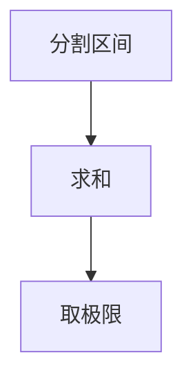

# 定积分入门

从“面积怎么算”这个朴素的问题出发，把曲线下的面积一步步变成可以计算的量。这一页同时是阅读器的验收样章，包含表格、代码、公式、提示块等全部元素。

## 面积与黎曼和

把区间 $[a,b]$ 等分成 $n$ 份，每份宽 $\Delta x = \frac{b-a}{n}$。取每份右端点的函数值，得到近似面积：

$$
S_n = \sum_{i=1}^{n} f(x_i)\,\Delta x
$$

当 $n \to \infty$ 时，$S_n$ 的极限就是定积分 $\int_a^b f(x)\,dx$。这里有一个故意写错的公式：$\frac{1}{$，用来检验降级显示。

> [!note] 先想一想
> 为什么取右端点而不是左端点，结果会一样吗？

> 这是一段普通块引用，不是提示块。

| 分割数 n | 近似值 | 误差 |
|---|---:|---:|
| 4 | 0.34375 | 0.01042 |
| 8 | 0.33594 | 0.00261 |

| 方法 | 适用场景 | 收敛阶 | 备注 | 额外说明列一 | 额外说明列二 | 额外说明列三 | 额外说明列四 |
|---|---|---|---|---|---|---|---|
| 左端点 | 单调递增函数的下界估计，用于快速检验 | 一阶 | 误差随 n 线性下降 | 这是一个很长的单元格内容用来撑宽表格 | 这是一个很长的单元格内容用来撑宽表格 | 这是一个很长的单元格内容用来撑宽表格 | 这是一个很长的单元格内容用来撑宽表格 |

### 用代码验证

```python
def riemann(f, a, b, n):
    dx = (b - a) / n
    return sum(f(a + i * dx) for i in range(1, n + 1)) * dx   # 右端点
```

```
中文  空格   与
换行
```

### 小结

- [x] 理解黎曼和
- [ ] 推出牛顿—莱布尼茨公式

这里有==重点内容==和另一处==需要记住的结论==。脚注示例[^1]。可以回看[[面积与黎曼和]]，但[[不存在的页面]]没有目标。

[^1]: 脚注正文只出现一次。

## 图示



```mermaid
graph TD
  A[这是一个语法错误的图 -->
```

## 安全检查

<script>window.__pwned = 1</script>

[危险链接](javascript:window.__pwned=3)

#不是标签 的文字。

# 练习

## 1.

计算 $\int_0^1 x^2\,dx$。

# 参考答案

## 1.

$\frac{1}{3}$

用黎曼和取极限即可得到。
